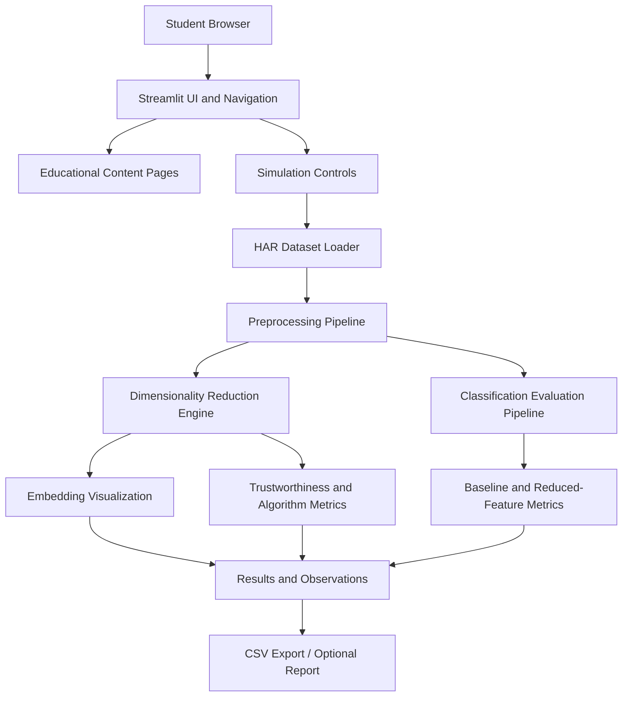

# Technical Requirements Document (TRD)
## Dimensionality Reduction Explorer — Interactive Machine Learning Virtual Laboratory

**Document version:** 1.0  
**Status:** Approved for implementation  
**Related document:** PRD — Dimensionality Reduction Explorer  
**Deployment target:** Streamlit Community Cloud  
**Primary dataset:** UCI Human Activity Recognition Using Smartphones (HAR)

---

## 1. Technical Overview

The application will be implemented as a modular Python Streamlit application. It will load the HAR dataset, apply dimensionality reduction algorithms, render interactive plots and metrics, and provide a structured educational interface.

The initial architecture is a single-process, server-rendered Streamlit app. A separate backend API and database are not required for the MVP.

### 1.1 Architecture goals
- Minimal setup and deployment complexity.
- Separation of presentation, data loading, algorithms, evaluation, and educational content.
- Reproducible algorithm execution.
- Avoid redundant computation through caching.
- Compatible with Streamlit Community Cloud.
- Readable source code suitable for academic review.

### 1.2 High-level architecture



---

## 2. Technology Stack

| Layer | Technology | Purpose |
|---|---|---|
| Language | Python 3.11 (recommended) | Main application and ML implementation |
| Web UI | Streamlit | Pages, navigation, controls, forms, session state |
| Numerical computation | NumPy | Matrix and array operations |
| Data handling | Pandas | Dataset inspection and result tables |
| ML algorithms | scikit-learn | PCA, TruncatedSVD, t-SNE, Logistic Regression, preprocessing, metrics |
| Nonlinear embedding | `umap-learn` | UMAP implementation |
| Interactive plotting | Plotly | 2D/3D scatter plots and metric charts |
| Static plotting (optional) | Matplotlib | Optional academic plots |
| Dataset | UCI HAR | High-dimensional classification dataset |
| Source control | Git and GitHub | Version control and deployment source |
| Hosting | Streamlit Community Cloud | Public app deployment |
| Testing | pytest | Unit and basic integration tests |

Use stable mutually compatible package versions and pin them in `requirements.txt`. Confirm compatibility in the deployment environment rather than relying on local package versions alone.

---

## 3. Dataset Technical Specification

### 3.1 Dataset details
- Dataset: UCI HAR Dataset.
- Features: 561 engineered sensor features.
- Target: 6 activity classes.
- Train/test split: use the provided predefined partition.
- Data representation: numeric feature matrix `X`; integer or string labels `y`.

### 3.2 Data loading
Create a dedicated loader module. The loader must:
1. Load the training and test feature files and label files.
2. Verify row count alignment.
3. Verify the feature count.
4. Verify that expected classes are represented.
5. Return separate `X_train`, `y_train`, `X_test`, `y_test`.
6. Provide dataset metadata and class-name mapping.
7. Raise a clear exception or display a useful UI message when files are missing or invalid.

### 3.3 Data source and packaging
Use the official UCI source or a verified repository copy. For deployment:
- Check repository file size and hosting constraints.
- Include a source citation and dataset license/terms.
- Do not commit a dataset copy until its redistribution terms are verified.
- If downloaded at runtime, use a stable source, validate the archive, and cache the extracted data.
- The app should show a clear loading/error message if network download is unavailable.

---

## 4. Preprocessing Pipeline

### 4.1 Classification pipeline
- Use the dataset's predefined train/test split.
- Use preprocessing fit on training data only.
- Use `StandardScaler` as appropriate for Logistic Regression and PCA-based workflows.
- Apply the fitted scaler to test data.
- Fit dimensionality reduction only on training features.
- Transform test features with the fitted reducer for PCA, TruncatedSVD, and UMAP.
- Fit Logistic Regression on transformed training data.
- Evaluate against transformed test features and test labels.

### 4.2 Visualization pipeline
- Visualization can use a selected sample or the full dataset, subject to runtime.
- Sampling must be reproducible.
- Plot points colored by activity class.
- Include class legend and axis labels.
- Avoid implying that an embedding's axes have direct physical meaning for t-SNE or UMAP.

### 4.3 t-SNE pipeline
- Standardize features before t-SNE where appropriate.
- Set random seed.
- Validate perplexity against the number of selected samples; perplexity must be less than the sample count.
- Apply bounded controls to avoid excessively expensive settings.
- Compute trustworthiness using the original feature space and resulting embedding, using a valid neighborhood parameter.
- Do not use t-SNE in the primary train/test classification comparison because standard scikit-learn t-SNE does not expose the same out-of-sample transform as PCA/SVD/UMAP.

---

## 5. Algorithm Implementation Requirements

### 5.1 PCA
Use `sklearn.decomposition.PCA`.

Inputs:
- Standardized feature matrix.
- Number of components.

Outputs:
- Embedding.
- `explained_variance_ratio_`.
- Cumulative explained variance.
- Runtime.
- Fitted model where useful.

Constraints:
- Component count must be valid for the sample and feature dimensions.
- PCA must be fitted on training data only in the classification evaluation pipeline.
- Explained variance is not a metric for t-SNE or UMAP.

### 5.2 Truncated SVD
Use `sklearn.decomposition.TruncatedSVD`.

Inputs:
- Feature matrix.
- Number of components.
- Random seed.

Outputs:
- Reduced embedding.
- Singular values.
- Runtime.
- Relevant explained variance information, only if correctly computed by the implementation.

Technical distinction:
- TruncatedSVD does not center the data by default.
- PCA and SVD should be described as related linear methods, not as identical procedures.
- Apply train-only fitting for downstream classification.

### 5.3 t-SNE
Use `sklearn.manifold.TSNE`.

Inputs:
- Feature matrix or a valid intermediate representation.
- `n_components` (MVP should prioritize 2).
- `perplexity`.
- `learning_rate`.
- `max_iter` (use the parameter name supported by the pinned scikit-learn version).
- `random_state`.
- `init` if configurable.

Outputs:
- Embedding.
- Trustworthiness.
- Runtime.

Validation:
- Perplexity is positive and less than the selected sample count.
- Bound iteration count and sample count.
- t-SNE is not expected to preserve global distances faithfully.
- Standard t-SNE has no equivalent fitted out-of-sample `transform()` workflow for the primary classification comparison.

### 5.4 UMAP
Use `umap.UMAP`.

Inputs:
- `n_components`.
- `n_neighbors`.
- `min_dist`.
- `random_state`.
- Optional metric only if the UI and theory support it.

Outputs:
- Embedding.
- Trustworthiness.
- Runtime.
- Fitted reducer for classification transformation.

Validation:
- `n_neighbors` must be valid for selected sample count.
- `min_dist` must be within the supported range.
- Use deterministic random seed.
- Fit UMAP on training features and transform test features for classification comparison.

---

## 6. Classification Evaluation Specification

### 6.1 Models
- Baseline: Logistic Regression on original 561-feature input.
- Reduced representations: PCA, TruncatedSVD, UMAP + Logistic Regression.

Use one consistent Logistic Regression configuration across comparisons unless a documented reason requires otherwise. Configure convergence controls (for example, `max_iter`) and report if convergence warnings occur.

### 6.2 Metrics
Use scikit-learn metrics:
- `accuracy_score`
- `precision_score` with `average="macro"`
- `recall_score` with `average="macro"`
- `f1_score` with `average="macro"`
- `confusion_matrix`

Use labels/class ordering consistently so the confusion matrix is interpretable.

### 6.3 Leakage prevention
The evaluation code must:
1. Keep train and test split fixed.
2. Fit scaler on training data only.
3. Fit dimensionality reduction on training data only.
4. Transform test data using the fitted reducer.
5. Fit classifier only on training representations and labels.
6. Evaluate only on test representations and labels.
7. Never select parameters using test labels.

### 6.4 Comparison display
Display a table with rows:
- Baseline (original features)
- PCA + Logistic Regression
- Truncated SVD + Logistic Regression
- UMAP + Logistic Regression

Columns:
- Reduced dimensions (baseline marked as original)
- Accuracy
- Macro precision
- Macro recall
- Macro F1
- Reduction time
- Classifier/evaluation time (if separately measured)

t-SNE should be presented in a separate visualization analysis table with:
- Embedding dimensionality
- Trustworthiness
- Runtime
- Parameters used

---

## 7. Trustworthiness Specification

Use `sklearn.manifold.trustworthiness`.

- Calculate against the original feature representation and its low-dimensional embedding.
- Use a valid `n_neighbors` value based on selected sample count.
- Explain that trustworthiness measures local neighborhood preservation and is not classification accuracy.
- Report the score on its supported scale and label it clearly.
- Avoid calculating the metric when constraints are not satisfied; show a clear message instead.

---

## 8. Streamlit Application Structure

### 8.1 Proposed project tree

```text
dimensionality-reduction-virtual-lab/
├── app.py
├── requirements.txt
├── README.md
├── .gitignore
├── data/
│   └── README.md
├── assets/
│   ├── logo.png                 # optional, if available
│   └── diagrams/                # optional educational diagrams
├── pages/
│   ├── 1_Overview.py
│   ├── 2_Aim_and_Theory.py
│   ├── 3_Pre_test.py
│   ├── 4_Simulation.py
│   ├── 5_Procedure.py
│   ├── 6_Observations.py
│   ├── 7_Exercises.py
│   ├── 8_Post_test.py
│   ├── 9_References.py
│   ├── 10_Contributors.py
│   └── 11_Feedback.py
├── src/
│   ├── __init__.py
│   ├── data_loader.py
│   ├── preprocessing.py
│   ├── dimensionality_reduction.py
│   ├── evaluation.py
│   ├── visualization.py
│   ├── quiz.py
│   └── report.py                 # optional
└── tests/
    ├── test_data_loader.py
    ├── test_reduction.py
    ├── test_evaluation.py
    └── test_quiz.py
```

This structure is a proposed maintainable layout. If native Streamlit multipage conventions or a simpler file structure better suit the implementation, preserve the logical separation.

### 8.2 Main application
`app.py` shall:
- Set page title, icon, and layout.
- Provide global navigation.
- Initialize session-state defaults.
- Display the experiment overview or landing page.
- Avoid embedding all algorithm logic in the UI entry point.

### 8.3 Simulation page
The Simulation page shall:
- Display dataset metadata.
- Provide algorithm selection.
- Display only controls relevant to the selected algorithm.
- Validate user input.
- Execute the selected algorithm on button press.
- Show loading/status messages.
- Display plot and metrics.
- Store the latest valid result in Streamlit session state.
- Provide reset behavior.
- Avoid running expensive calculations on every widget change.

---

## 9. UI and Visualization Requirements

### 9.1 Plotly embedding plot
- x-axis and y-axis represent embedding dimensions.
- Marker color represents HAR activity class.
- Include legend and hover details where feasible.
- Use consistent activity-class mapping across algorithms.
- Use readable plot titles containing the selected algorithm and dimensions.

### 9.2 PCA plots
- Explained variance ratio bar chart.
- Cumulative explained variance line chart.
- Optional component loading visualization if feasible and correctly labeled.

### 9.3 SVD plots
- Singular value plot.
- Optional explained variance display only when correctly supported by the implementation.

### 9.4 Classification plots
- Metric comparison bar chart.
- Confusion matrix heatmap for selected evaluation.
- Clear labels and consistent metric scales.

### 9.5 Result table
Include selected algorithm, parameters, embedding dimensions, trustworthiness when applicable, and runtime. Do not display unavailable metrics as zero; use `N/A` or omit them.

---

## 10. State Management and Caching

Use Streamlit features appropriately:
- `st.cache_data` for dataset loading and deterministic data preparation.
- `st.cache_resource` only for reusable fitted resources where appropriate and safe.
- `st.session_state` for current algorithm selection, parameters, last simulation result, quiz responses, and run status.

Caching considerations:
- Include relevant parameters and random seed in cache identity.
- Avoid caching mutable objects in a way that causes cross-session result corruption.
- Avoid retaining unnecessarily large embeddings or duplicated arrays.
- Provide a reset/clear action if stale results could confuse users.

---

## 11. Performance and Resource Limits

Because Streamlit Community Cloud may have limited CPU and memory:
- Limit visualization sample count with a clearly disclosed sampling option.
- Cache the dataset loader.
- Bound t-SNE iterations, perplexity, and selected sample count.
- Avoid automatically rerunning reductions when unrelated controls change.
- Show a spinner or status message for longer computations.
- Use a practical default configuration that completes promptly.
- Do not promise a fixed runtime across hosting environments.
- Test the complete app on the deployment environment.

Suggested initial defaults (adjust after benchmarking):
- Embedding dimensions: 2.
- Random seed: 42.
- Visualization sample: a moderate reproducible subset, or full dataset if runtime is acceptable.
- t-SNE perplexity: 30, provided sample count is valid.
- UMAP `n_neighbors`: 15.
- UMAP `min_dist`: 0.1.
- Classification Logistic Regression: a fixed, documented configuration with adequate convergence limit.

These are implementation defaults, not scientific conclusions. Parameter bounds and defaults must be validated against actual package behavior and runtime.

---

## 12. Dependencies and Deployment

### 12.1 Requirements file
Include direct dependencies, with compatible versions pinned after local and cloud testing:
- streamlit
- numpy
- pandas
- scikit-learn
- plotly
- umap-learn
- scipy (if directly required)
- pytest (development/test dependency, optional for runtime)

### 12.2 Streamlit Community Cloud deployment
1. Push project to GitHub.
2. Ensure `app.py` is the entry point.
3. Add the tested `requirements.txt`.
4. Verify dataset packaging/download method.
5. Deploy from Streamlit Community Cloud.
6. Verify every page and each algorithm on the deployed URL.
7. Record the deployment URL in the project README and assessment materials.

### 12.3 Secrets
- MVP does not require secrets or API keys.
- Do not store credentials in source code.
- If any external service is added later, use Streamlit secrets.

### 12.4 README requirements
README should include:
- Project description.
- Learning objectives.
- Features.
- Dataset source/citation.
- Local setup commands.
- Run command.
- Deployment instructions.
- Project structure.
- Limitations and evaluation methodology.
- Contributors.

---

## 13. Testing Requirements

### 13.1 Unit tests
- Dataset loader returns aligned arrays and expected feature count.
- Dataset labels are within expected class set.
- PCA returns requested dimensions for valid input.
- TruncatedSVD returns requested dimensions.
- t-SNE validation rejects perplexity greater than or equal to sample count.
- UMAP returns expected embedding shape for valid parameters.
- Trustworthiness returns a valid numeric score for supported input.
- Classification metrics are computed correctly on a small known sample.
- Quiz scoring returns the expected score.

### 13.2 Integration tests
- Simulation page can execute each algorithm with valid default parameters.
- Results render after execution.
- Classification comparison completes for baseline, PCA, SVD, and UMAP.
- Invalid inputs display user-facing feedback.
- Session state retains latest result as intended.

### 13.3 Manual deployment checks
- Home page loads.
- Navigation sections open.
- Dataset loads in cloud.
- All four algorithm runs work.
- Plots render.
- Metrics are displayed and not fabricated.
- Pre-test and post-test scoring work.
- No missing references or contributor placeholders that misrepresent project details.
- App remains usable after refresh/restart.
- Public URL works in a separate browser session.

---

## 14. Error Handling

The application should handle:
- Missing dataset or failed download.
- Invalid component count.
- t-SNE perplexity incompatible with sample count.
- UMAP neighbor count incompatible with sample count.
- Empty or invalid selected sample.
- Algorithm convergence warnings.
- Memory or runtime limitations.
- Plot rendering errors.

Errors should be concise, understandable, and actionable. Technical details may be logged or shown in an expandable diagnostic area, but should not overwhelm students.

---

## 15. Security and Privacy

- No authentication or personal student information is required for MVP.
- Do not collect student names, IDs, or sensitive information in feedback.
- If feedback is not persisted, clearly disclose that.
- Do not include secrets in GitHub.
- Use trusted dataset and package sources.
- Treat any later user-uploaded data feature as a separate security and privacy requirement.

---

## 16. Implementation Sequence

### Phase 1 — Core computation
1. Establish Python environment and dependencies.
2. Implement and verify HAR loader.
3. Implement preprocessing.
4. Implement PCA, SVD, t-SNE, and UMAP wrappers.
5. Implement trustworthiness and classification evaluation.
6. Verify train/test leakage prevention.

### Phase 2 — Simulation UI
1. Create Streamlit app shell and navigation.
2. Build simulation controls and validation.
3. Add embedding plots and algorithm-specific metrics.
4. Add classification comparison.
5. Add status, runtime, and session-state behavior.

### Phase 3 — Educational content
1. Add Aim and Theory.
2. Add Pre-test and Post-test with answer feedback.
3. Add Procedure and Exercises.
4. Add Observations and References.
5. Add Contributors and Feedback.

### Phase 4 — Validation and deployment
1. Run unit and manual tests.
2. Benchmark defaults and constrain expensive settings.
3. Pin dependencies.
4. Deploy to Streamlit Community Cloud.
5. Run end-to-end tests on the public URL.
6. Prepare the demonstration path.

---

## 17. Technical Acceptance Checklist

- [ ] HAR loader verifies 561 features and six activity classes.
- [ ] Original train/test partition is used for classification.
- [ ] PCA output dimensions and explained variance are correct.
- [ ] TruncatedSVD output dimensions and singular values are correct.
- [ ] t-SNE output is reproducible under a fixed seed and valid parameters.
- [ ] UMAP output is reproducible under a fixed seed and valid parameters.
- [ ] Trustworthiness is calculated only for valid input.
- [ ] Classification pipeline fits preprocessing/reducers on training data only.
- [ ] Test set is not used for fitting or parameter selection.
- [ ] Baseline, PCA, SVD, and UMAP classification metrics are displayed.
- [ ] t-SNE is reported separately for embedding analysis.
- [ ] All educational sections are accessible.
- [ ] Error messages are actionable.
- [ ] Dependencies install in the deployment environment.
- [ ] Public Streamlit deployment has been verified.

---

## 18. Technical Decisions and Rationale

| Decision | Rationale |
|---|---|
| Streamlit rather than a custom frontend/backend | Fast implementation, suitable for an academic demo, integrated Python execution. |
| HAR dataset | High-dimensional dataset with 561 features and six activity classes, aligned with the experiment aim. |
| PCA, TruncatedSVD, t-SNE, UMAP | Includes linear and nonlinear approaches with contrasting strengths. |
| Logistic Regression as common classifier | Simple, interpretable, and practical for comparing feature representations. |
| Predefined HAR split | Supports repeatable benchmark comparison. |
| Train-only fit for preprocessing/reduction | Prevents data leakage. |
| Separate t-SNE evaluation | Standard t-SNE lacks the same out-of-sample transform workflow. |
| Trustworthiness for embeddings | Quantifies local neighborhood preservation, complementing visual inspection. |
| Streamlit Community Cloud | Public deployment with low setup overhead for the assessment. |

---

## 19. Open Implementation Notes

The following items should be confirmed during coding and benchmarking, not treated as fixed facts:
- Exact dependency versions compatible with Python and Streamlit Cloud.
- Whether HAR data should be packaged in the repository or downloaded/cached at runtime.
- Practical sample count and iteration defaults for t-SNE and UMAP on the deployed instance.
- Whether PDF report generation and CSV download can fit within the MVP deadline.
- Contributor details and faculty guide information, which must come from the project owner.
